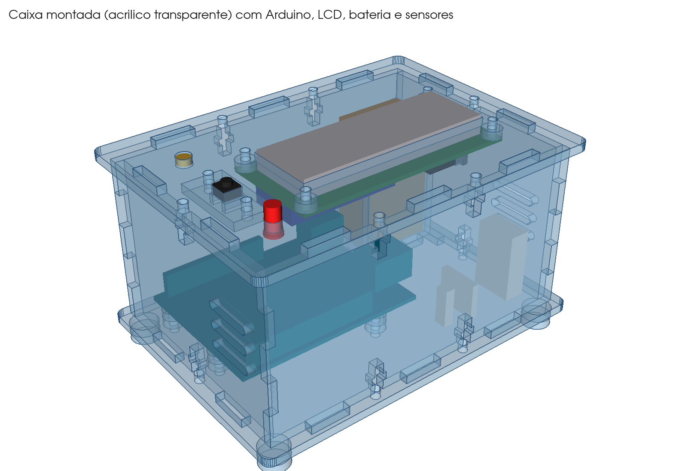
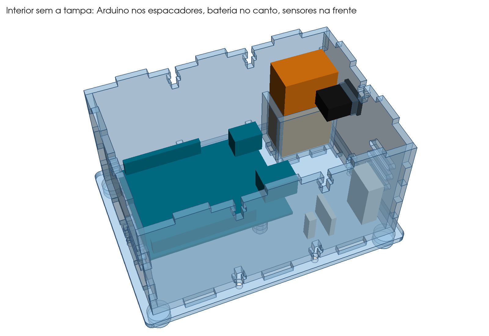
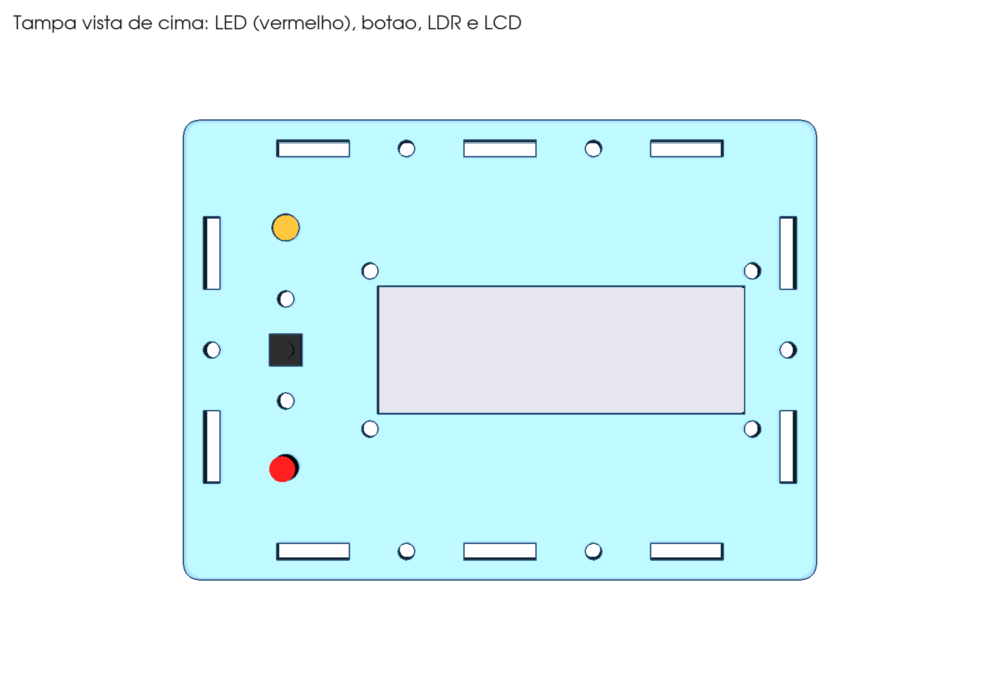
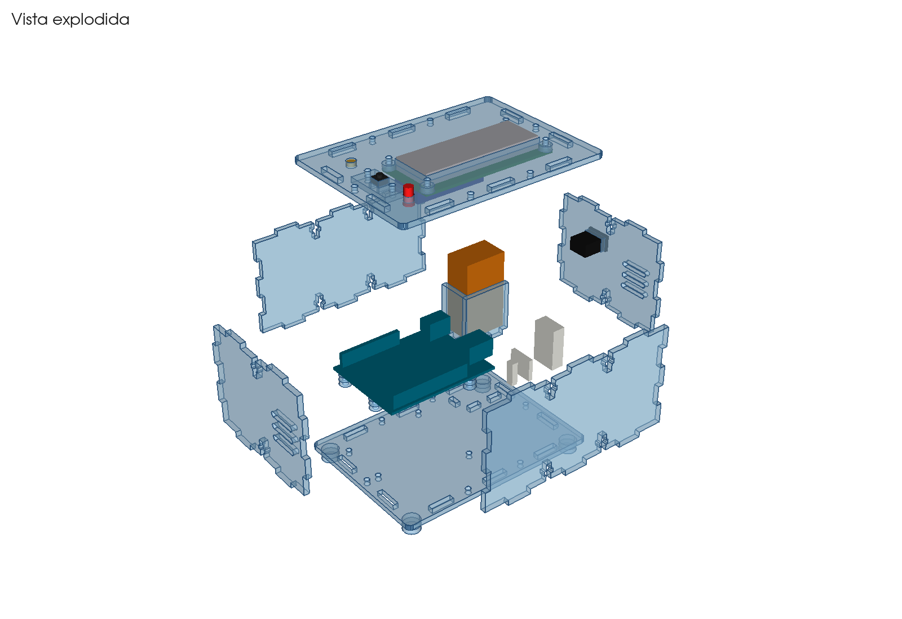
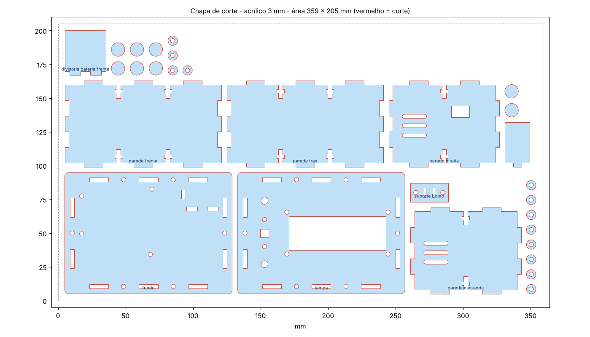

# Caixa de acrílico da Estação Meteorológica (versão compacta)

Caixa parafusada em acrílico de 3 mm, cortada a laser, para o Arduino Uno R3,
o LCD 16x2 (com módulo I2C), a bateria de 9 V e os sensores.

## Medidas

| | |
|---|---|
| Espaço interno | 110 x 76 x 58 mm |
| Fundo e tampa | 124 x 90 mm (sobram 4 mm pra fora das paredes) |
| Altura total | 64 mm, mais 6 mm dos pés |
| Chapa necessária | uma área de 359 x 205 mm de acrílico de 3 mm |

A altura é a mínima pra bateria de 9 V caber em pé com o clip.

## O que tem nesta pasta

| Arquivo | Para que serve |
|---|---|
| `fusion/CaixaEstacao/` | **Script do Fusion 360.** Desenha a caixa inteira, com uma peça por componente, e as medidas ficam todas no começo do arquivo |
| `step/caixa_estacao_montada.step` | Modelo 3D montado. Abre direto no Fusion. Tem as peças de acrílico e, separado, o Arduino, o LCD, a bateria e os sensores só como referência |
| `dxf/chapa_corte_completa.dxf` | **Arquivo pro laser**: todas as peças, nas quantidades certas, numa área de 359 x 205 mm |
| `dxf/pecas/*.dxf` | Uma peça por arquivo (`_x12` e `_x8` no nome dizem quantas cortar) |
| `previa/*.png` | Imagens: montada, explodida, interior, tampa e chapa de corte |
| `fonte/` | O código Python que gerou tudo (`geometria.py` tem as medidas) |

Todos os DXF estão em milímetros, na camada `CORTE` (vermelha), e só têm linhas de corte.

## Como abrir no Fusion 360

**Opção 1: o modelo pronto (STEP).** No Fusion, vá em *File > Open > Open from my computer* e
escolha `caixa_estacao_montada.step`. Cada peça vira um componente.

**Opção 2: o script (pra mudar medidas).**
1. *Utilities > Add-Ins > Scripts and Add-Ins* (atalho **Shift+S**).
2. Clique no **+** ao lado de *My Scripts* e escolha a pasta `fusion/CaixaEstacao`.
3. Selecione **CaixaEstacao** e clique em **Run**. Ele abre um projeto novo com:
   - `Acrilico_cortar`: as peças. Cada uma tem um esboço `corte_...`. Clique com o botão
     direito nele e escolha *Save As DXF* pra mandar pro laser.
   - `Referencias_nao_cortar`: Arduino, LCD, bateria, chave, botão, LED, LDR e sensores,
     só pra conferir se cabe.

Se o Fusion não aceitar a pasta, crie um script novo pelo próprio Fusion (*Create*, Python),
abra ele no editor e cole todo o conteúdo de `CaixaEstacao.py` no lugar.

Pra mudar uma medida, edite o bloco `PARAMETROS` no começo do `CaixaEstacao.py` e rode de novo.
Por exemplo, a espessura da chapa, o tamanho da caixa, a posição do LCD ou dos furos da tampa,
quais paredes têm ventilação (`vent_paredes`) e o furo da chave. Também dá pra editar direto no
Fusion: abra o esboço `corte_...` da peça, mova ou mude o furo, e a peça se atualiza.

## Como a caixa é montada

- **Paredes**: encaixe tipo "dedo" nos cantos. As abas de baixo entram nos rasgos do fundo e as
  de cima nos rasgos da tampa.
- **Parafusos M3 com porca em T**: o parafuso passa pelo fundo (ou pela tampa) e entra na borda
  da parede. A porca fica presa no rasgo em forma de T. São 6 embaixo e 6 em cima, e a tampa sai
  só tirando os 6 de cima.
- **Arduino**: fica atrás, à esquerda, em cima de 2 arruelas de acrílico (6 mm) em cada furo,
  sem encostar no fundo. O USB fica virado pra direita, com uns 30 mm livres pra plugar o cabo
  com a tampa aberta.
- **Bateria 9 V**: fica em pé no canto de trás à direita, dentro de duas divisórias de 30 mm de
  altura que encaixam no fundo. O plug P4 do Arduino fica encostado na divisória, então a
  bateria liga no **Vin** passando pela chave.
- **Sensores**: na frente, à direita, encostados na ventilação e longe do Arduino, que esquenta.
  Prenda com fita dupla face, cola quente ou numa plaquinha perfurada pequena (até uns 35 x 20 mm).
- **Tampa**: janela do LCD (72 x 25 mm) à direita. À esquerda, de frente pra trás: LED (furo de
  5,1 mm), botão 6x6 (furo quadrado de 6,3 mm) e LDR (furo de 5,3 mm) virado pra cima.
- **Chave liga/desliga**: mini gangorra KCD11 na parede direita, atrás (furo de 13,5 x 8,5 mm).
- **Ventilação**: só 3 rasgos na parede esquerda e 3 na direita, na frente, na altura dos
  sensores. O ar entra de um lado e sai do outro.

## Lista de material

| Item | Qtd | Onde vai |
|---|---|---|
| Acrílico 3 mm (área de 359 x 205 mm) | 1 | todas as peças |
| Parafuso M3 x 12 + porca | 12 | fechamento em T (6 no fundo, 6 na tampa) |
| Parafuso M3 x 16 + porca | 4 | Arduino (fundo 3 + arruelas 6 + placa 1,6 + porca 2,4 mm) |
| Parafuso M3 x 10 ou x 12 + porca | 6 | LCD (4) e suporte do botão (2) |
| Chave gangorra mini KCD11 | 1 | parede direita |
| Botão táctil 6x6 com **altura de 5 mm ou mais** | 1 | tampa |
| LED 5 mm e LDR 5 mm | 1 cada | tampa (presos com cola quente por baixo) |
| Clip de bateria 9 V | 1 | |
| Cola para acrílico ou cola instantânea | | pés, divisórias e, se quiser, os cantos |

As arruelas espaçadoras (12) e os pés (8 discos) já estão na chapa de corte.

## Montagem passo a passo

1. **Antes de cortar tudo**, corte só o `suporte_botao` e uma `arruela`. O parafuso M3 tem que
   passar sem forçar. Meça a chapa com paquímetro: se não for 3,0 mm, mude `espessura` e gere de novo.
2. **Fundo**: cole as duas divisórias da bateria nos rasgos delas.
3. **Arduino**: passe o parafuso M3 x 16 por baixo do fundo, coloque 2 arruelas, depois o
   Arduino e a porca. Faça isso nos 4 furos.
4. **Paredes**: encaixe as abas no fundo e junte os cantos. Coloque uma porca em cada rasgo T de
   baixo e aperte o parafuso M3 x 12 por baixo. **Não aperte demais**, porque acrílico trinca.
5. **Chave**: encaixe a KCD11 por fora da parede direita. Ela trava sozinha.
6. **Tampa**:
   - LCD por baixo, com 1 arruela entre a tampa e a placa em cada furo. Use parafuso M3 x 10 e
     porca. A moldura metálica passa pela janela.
   - LED e LDR: empurre de baixo pra cima e prenda com cola quente.
   - Botão: o corpo do 6x6 entra no furo quadrado. O `suporte_botao` vai por baixo, com as 4
     perninhas passando pelos 2 rasgos dele, e prende com 2 parafusos M3. A haste fica uns 2 mm
     acima da tampa.
7. **Ligação da bateria**: o positivo (vermelho) vai pra chave, e da chave pro **Vin** do
   Arduino. O negativo (preto) vai pro **GND**.
8. **Fechar**: encaixe a tampa (porcas nos T de cima) e coloque os 6 parafusos M3 x 12.
9. **Pés**: cole 2 discos empilhados em cada canto, por baixo. Eles deixam as cabeças dos
   parafusos longe da mesa.

## Medidas que eu supus (confira antes do corte)

- **Moldura do LCD**: 71,2 x 24,2 mm (janela de 72 x 25 mm). Placa de 80 x 36 mm, furos a
  75 x 31 mm. Se a moldura do teu for maior, aumente `lcd_janela_x` e `lcd_janela_y`.
- **Furos do LCD**: alguns módulos têm furo de 2,5 mm. Se o M3 não passar, alargue com broca de 3 mm.
- **Botão 6x6**: precisa ter 5 mm ou mais de altura total (6x6x5, 6x6x7...). Os mais baixos
  (6x6x4,3) ficam quase rentes à tampa.
- **Chave**: KCD11 mini (furo de 13,5 x 8,5 mm). Se a tua for a KCD1 maior, mude o furo pra 19 x 13 mm.
- **Bateria 9 V**: 48,5 x 26,5 x 17,5 mm.

## Avisos

- **Duração da bateria**: uma 9 V comum (cerca de 500 mAh) dura umas 6 a 8 horas com o LCD aceso.
- **Temperatura**: o regulador do Arduino esquenta, ainda mais com 9 V. Por isso os sensores
  ficam na frente, encostados na ventilação. Com pouca ventilação, a temperatura de dentro pode
  ficar um pouco acima da de fora: vale conferir com um termômetro e ajustar a calibração.
- **Acrílico transparente conduz luz**: o LED e a luz do LCD podem chegar até o LDR por dentro
  da chapa. Se a leitura de luz ficar estranha, pinte de preto a borda do furo do LDR ou use um
  tubinho de termorretrátil preto nele.
- **Folga do laser**: os desenhos estão na medida nominal. Os rasgos das abas já têm 0,2 mm de
  folga e não precisa compensar o kerf.

