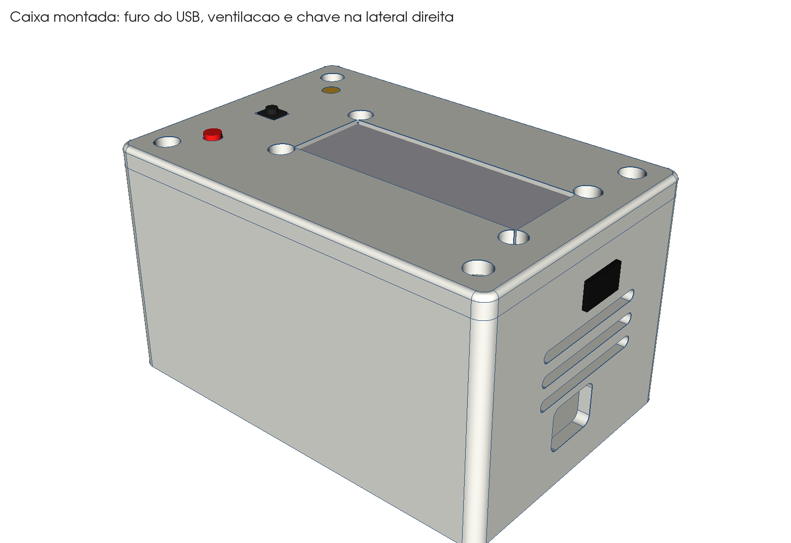
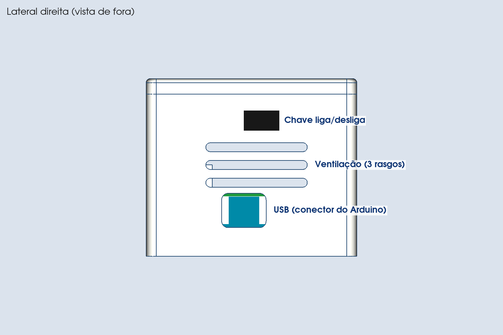
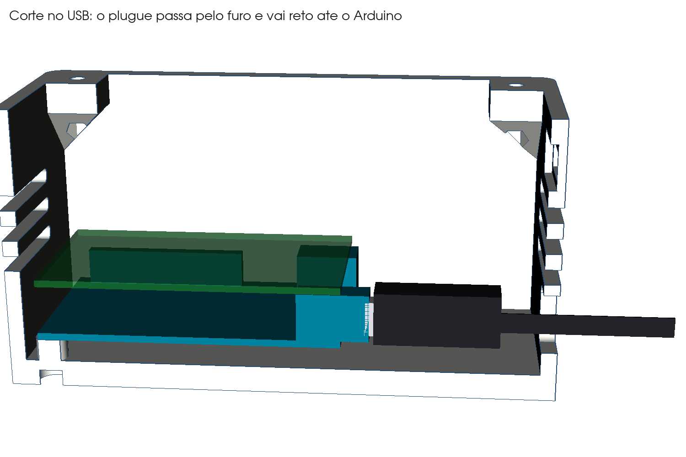
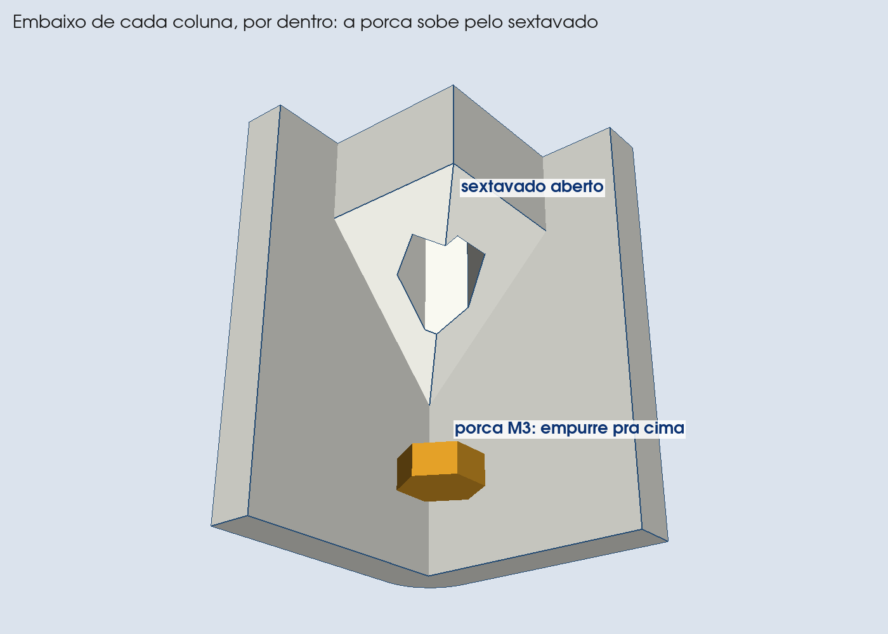
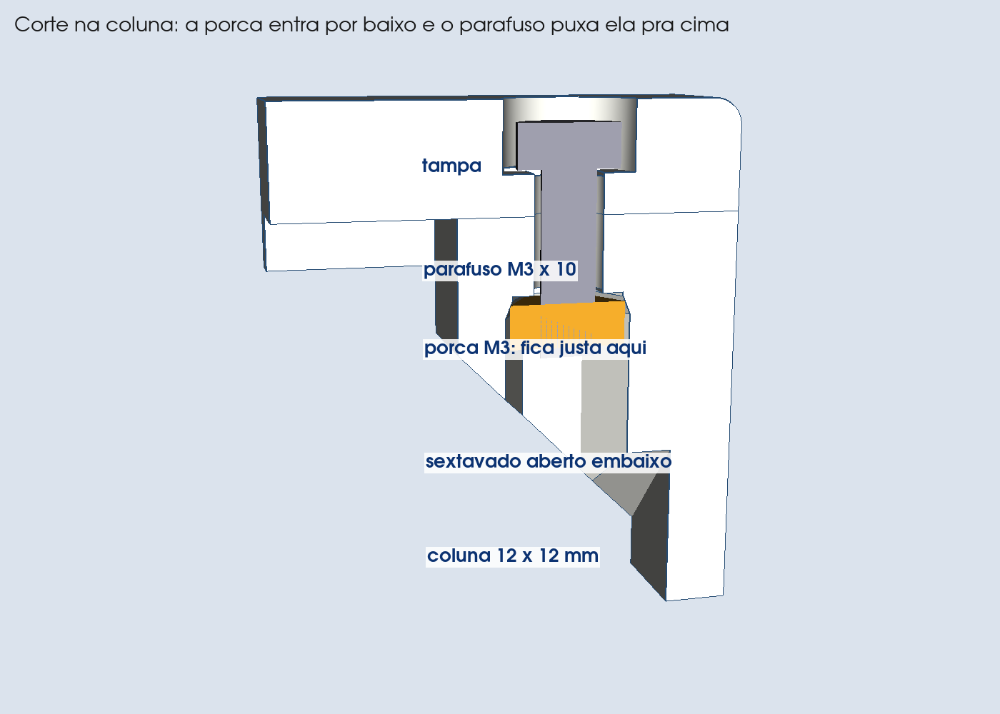

# Caixa da Estação Meteorológica para impressão 3D (versão 2)

São duas peças: o **corpo**, com o fundo e as quatro paredes numa peça só, e a **tampa**,
parafusada de cima pra baixo. Cabem o Arduino Uno R3 com o shield dos sensores, o LCD 16x2 com
I2C, a bateria de 9 V e a chave liga/desliga.



## O que mudou da versão 1

- **Furo do USB** na lateral direita, a mesma da ventilação e da chave. Ele fica alinhado com o
  conector do Arduino, então dá pra plugar o cabo com a caixa fechada.
- Pra caber o USB embaixo dos rasgos, a **ventilação subiu 7 mm** (nos dois lados) e a **chave
  subiu 7,5 mm** e veio 4 mm pra frente. Continuam os 3 rasgos de 40 mm de cada lado.
- **Colunas da tampa mais parrudas**: 12 x 12 mm (eram 8 x 8). A parte reta fica só em volta
  da porca, e embaixo a coluna afina a 45° até o canto.
- **Mais folga nos furos dos parafusos**: furo de 3,8 mm (era 3,4) e rebaixo da cabeça de
  7,2 mm (era 6,6).
- **Porca da tampa entra por baixo da coluna**, com a peça já impressa. Não tem pausa nem o
  rasgo do lado que enchia de suporte. O sextavado é aberto embaixo e afina no topo, então a
  porca sobe solta e fica justa lá em cima, sem cair (veja a montagem).
- Os furos que saem de um rebaixo ou do sextavado da porca começam com 2 camadas de "ponte em degrau".
  Assim a impressora não precisa de suporte e não cai rebarba dentro do furo.
- O LED foi 1 mm pra trás, pra ficar longe da coluna nova.
- **Furo da chave de 12 x 6 mm**, pra chave nova (a cinza).
- **Borda de baixo reta**: só os 4 cantos em pé continuam arredondados. Assim a primeira camada
  pega a base inteira.

O tamanho por fora não mudou: o corpo tem 123 x 83 x 64 mm, e com a tampa são 70 mm de altura.

## O que tem nesta pasta

| Pasta / arquivo | Para que serve |
|---|---|
| `imprimir/corpo.stl` | **Pra imprimir.** Já vem em pé, com o fundo na mesa |
| `imprimir/tampa.stl` | **Pra imprimir.** Já vem de cabeça pra baixo |
| `fusion/caixa_montada.step` | Modelo montado pra abrir no Fusion. Os componentes, parafusos e porcas vêm em grupos separados, só como referência |
| `fusion/corpo.step` e `fusion/tampa.step` | Cada peça sozinha, pra editar no Fusion |
| `fotos/` | Imagens de conferência |
| `codigo/` | Os scripts que geram tudo. As medidas ficam no começo do `caixa3d.py` |

## Como imprimir

| | Corpo | Tampa |
|---|---|---|
| Posição | Em pé, com o fundo na mesa (já vem assim) | De cabeça pra baixo, com a face de cima na mesa (já vem assim) |
| Suporte | **Desligado** | **Desligado** |
| Pausa | Não precisa | Não precisa |

Configuração sugerida no Bambu Studio:
- **Camada** de 0,2 mm, que é o perfil "0.20mm Standard".
- **Paredes (perímetros)**: 4. Assim a parede de 3,5 mm sai praticamente maciça.
- **Preenchimento**: 20 %.
- **Material**: PLA serve. Se a caixa for ficar no sol ou num lugar quente, use PETG, porque o
  PLA amolece perto dos 55 °C.

**Deixe o suporte desligado.** Nenhuma parte precisa dele. E não tem mais nenhum buraco fechado
por dentro: o sextavado das colunas é aberto por baixo, então, se algum suporte entrar ali, dá
pra tirar.

A impressão vai direto, sem pausa. As porcas entram depois, com a peça pronta (veja a
montagem). Dá pra imprimir o corpo e a tampa juntos na mesma mesa.

O que a impressora faz sem suporte:
- As colunas dos cantos começam afinando a 45° por baixo.
- No teto de cada sextavado e de cada rebaixo de cabeça, 2 camadas de ponte curta (até 4 mm).
- O furo do USB faz uma ponte de 17,5 mm, e o furo da chave, de 12 mm.
- Os rasgos de ventilação fazem uma ponte de uns 36 mm. A maioria das impressoras faz isso sem
  suporte. Se o teto do rasgo cair um pouquinho por dentro, não atrapalha.

## Como a caixa é montada

- **Fechamento**: em cada canto do corpo tem uma coluna de 12 x 12 mm. Por baixo dela tem um
  sextavado aberto: a porca M3 sobe por ali e fica justa uns 4,7 mm abaixo do topo da coluna. O
  parafuso desce pela tampa, com a cabeça escondida no rebaixo, e pega a porca. Quando aperta,
  ele puxa a porca contra o teto do sextavado, então a tampa fica presa no corpo. A aba de 3 mm
  embaixo da tampa entra no corpo e centraliza a tampa.
- **USB**: o furo da lateral direita (17,5 x 13,5 mm) fica bem na frente do conector do Arduino,
  a 38 mm dele. Empurre o plugue reto pelo furo até encaixar. Passa o plugue USB-B com capa de
  até 16 x 12 mm, que é o tamanho comum. O cabo pode ficar plugado com a tampa fechada.
- **Arduino**: atrás, à esquerda, em 4 pés de 5 mm. O parafuso entra por baixo do fundo, com a
  cabeça escondida no rebaixo, e a porca fica em cima da placa.
- **Shield com os sensores**: encaixa em cima do Arduino. Do shield até a tampa sobram 35 mm ou
  mais em quase 3/4 da placa, e embaixo do módulo I2C do LCD sobram 23 mm. Por isso o DHT22, que
  é o mais alto, vai na metade esquerda, perto dos rasgos.
- **Bateria 9 V**: em pé no canto da frente à direita, num bolso com paredinhas de 30 mm.
- **Chave liga/desliga**: a chave cinza, num furo de 12 x 6 mm na lateral direita, acima dos
  rasgos. Em volta do furo, a parede é afinada por dentro pra 1,8 mm, pra que as travinhas da
  chave prendam.
- **Ventilação**: 3 rasgos de 40 x 3,5 mm em cada lateral, na altura dos sensores do shield.
  O ar entra de um lado, passa por cima do shield e sai do outro.
- **Tampa**:
  - LCD à direita, preso por baixo em 4 pezinhos de 2 mm. A moldura metálica fica 1 mm abaixo
    da superfície da tampa.
  - À esquerda, de frente pra trás: LED, botão 6x6 e LDR virado pra cima.
- **Pés**: não tem. Cole pés de borracha nos cantos de baixo.




## Lista de material

Todos os parafusos são M3, de cabeça Phillips.

| Item | Qtd | Onde vai |
|---|---|---|
| Parafuso M3 x 10 + porca | 4 | tampa nas colunas (M3 x 12, x 16 ou x 20 também servem) |
| Parafuso M3 x 10 + porca | 4 | LCD (M3 x 12 também serve) |
| Parafuso M3 x 12 + porca | 4 | Arduino (M3 x 14 ou x 16 também servem) |
| Chave liga/desliga pequena (a cinza, furo de 12 x 6 mm) | 1 | lateral direita |
| Botão táctil 6x6 com **altura de 5 mm ou mais** | 1 | tampa |
| LED 5 mm e LDR 5 mm | 1 cada | tampa (presos com cola quente por baixo) |
| Clip de bateria 9 V | 1 | |
| Pés de borracha | 4 | cantos de baixo |

Na tampa, o parafuso tem que ter de 10 a 20 mm. Com menos de 10 ele não pega a porca inteira.

## Montagem passo a passo

1. **Porcas da tampa** (faça primeiro, com a caixa vazia):
   1. Por dentro, embaixo de cada coluna dos cantos, tem um sextavado aberto. Encaixe uma porca
      M3 deitada nele e empurre pra cima com o dedo. Ela sobe solta.
   2. Segurando a porca ali, passe um parafuso M3 por cima da coluna, sem a tampa, e aperte até
      sentir firme. O parafuso puxa a porca até ela ficar justa lá em cima.
   3. Tire o parafuso. A porca fica presa e não cai.
   4. Se alguma porca ficar frouxa e cair, ponha uma gotinha de cola nas laterais dela, sem
      deixar escorrer pra rosca, e encaixe de novo.

   
   

2. **Arduino**: passe os parafusos M3 x 12 por baixo do fundo, coloque o Arduino nos pés e
   aperte as porcas por cima da placa.
3. **Chave**: encaixe a chave por fora, no furo da lateral direita. Se ela não travar sozinha,
   prenda com uma gota de cola quente por dentro.
4. **Bateria**: coloque em pé no bolso da frente.
5. **Shield**: encaixe o shield com os sensores em cima do Arduino.
6. **Tampa**:
   - **LCD**: vai por baixo, apoiado nos pezinhos. Os parafusos M3 x 10 descem de cima, com a
     cabeça no rebaixo, e a porca fica embaixo da placa do LCD.
   - **LED e LDR**: empurre de baixo pra cima e prenda com cola quente.
   - **Botão**: entra por cima, no bolso quadrado. As 4 perninhas passam pelos 2 rasgos e
     aparecem num rebaixo por baixo da tampa. Solde os fios ali e ponha uma gota de cola quente
     pra segurar.
7. **Ligação da bateria**: o positivo (vermelho) vai pra chave, e da chave pro **Vin** do
   Arduino. O negativo (preto) vai pro **GND**.
8. **Fechar**: encaixe a tampa (a aba entra no corpo) e aperte os 4 parafusos nas porcas que já
   estão dentro das colunas. **Não aperte demais.**
9. **Pés**: cole os pés de borracha nos cantos de baixo.
10. **USB**: com a caixa fechada, empurre o plugue reto pelo furo da lateral direita.

## Folgas e medidas que eu supus

- **Folgas de impressão**:
  - Furo de passagem M3: 3,8 mm.
  - Rebaixo da cabeça: Ø 7,2 x 3,6 mm.
  - Sextavado da porca da tampa: 6,0 mm entre faces (a porca tem 5,5 x 2,4 mm), e no último
    1 mm ele afina até 5,3 mm. A porca sobe solta e trava uns 0,3 mm abaixo do teto, sem girar.
    Se a tua impressão sair mais justa, ela trava um pouco mais embaixo, e o parafuso puxa o
    resto.
  - Aba da tampa: 0,25 mm de folga de cada lado.
  - Se algum furo ainda ficar justo na tua impressora, passe uma broca de 4 mm, ou mude
    `furo_m3` no `codigo/caixa3d.py` e gere de novo.
- **USB**: furo de 17,5 x 13,5 mm, com o centro 18 mm acima da mesa (12 mm acima do fundo por
  dentro).
- **LCD**: moldura de 71,2 x 24,2 mm, janela de 72 x 25 mm. Placa de 80 x 36 mm, com furos a
  75 x 31 mm. Alguns módulos têm furo de 2,5 mm. Se o M3 não passar, alargue com broca de 3 mm.
- **Botão 6x6**: precisa ter 5 mm ou mais de altura total.
- **Chave**: furo de 12 x 6 mm, a medida da chave cinza. No desenho ele tem 12,2 x 6,2 mm,
  porque o furo sai um pouco menor na impressão.
- **Bateria 9 V**: 48,5 x 26,5 x 17,5 mm.

## Como abrir no Fusion 360

No Fusion, vá em *File > Open > Open from my computer* e escolha `fusion/caixa_montada.step`.
Cada peça vira um componente.

O STEP não traz o histórico de modelagem. Dá pra mexer com as ferramentas de edição direta, como
*Press Pull*, *Move* ou *Offset Face*, ou desenhando um esboço numa face e cortando com
*Extrude*. Depois, clique com o botão direito no corpo ou na tampa e escolha *Save As Mesh* pra
gerar o STL.

## Como gerar tudo de novo pelo código

Precisa do Python e do CadQuery:

```
pip install cadquery
python codigo/gerar.py
```

Ele grava por cima das pastas `imprimir`, `fusion` e `fotos` e mostra as conferências: se alguma
peça bate em outra, se o plugue USB passa, até onde vai cada parafuso e se a porca sobe por
baixo e trava na coluna.

## Avisos

- **Duração da bateria**: uma 9 V comum (cerca de 500 mAh) dura umas 6 a 8 horas com o LCD
  aceso. Com o cabo USB plugado e a chave desligada, o Arduino funciona pelo USB, sem gastar a
  bateria.
- **Temperatura**: o regulador do Arduino esquenta, ainda mais com 9 V, e os sensores ficam no
  shield, logo em cima dele. A leitura pode sair um pouco acima da temperatura de fora. Deixe o
  DHT22 e o LM35 na beira esquerda do shield, junto dos rasgos, e confira com um termômetro pra
  ajustar a calibração.
- **Luz no LDR**: se imprimir em cor clara ou translúcida, a luz do LED e do LCD pode passar pelo
  plástico e chegar no LDR. Imprima em cor escura ou pinte de preto a borda do furo do LDR.
